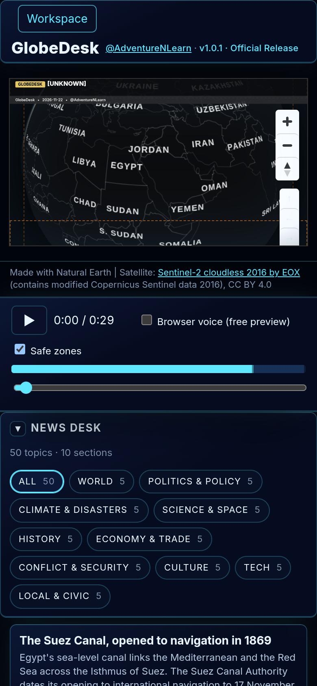

# GlobeDesk

**A free, local newsdesk and video studio on a talking globe.**

Pick your stories and the globe flies from orbit down to street level for each one. Cards pin to the place, every source carries a verified or unverified label, captions are always on, and you can record the result as a 16:9 or 9:16 video. It runs in your browser. You don't need an account, a server or an API key.

> **v1.3.0 · Share & Export** · by [@AdventureNLearn](https://x.com/AdventureNLearn) · The public live copy at [globedesk.grok.me](https://globedesk.grok.me) remains v1.0.1 until this branch is released. This branch has not been uploaded to grok.me yet.

## Civic Intelligence Project, open source

GlobeDesk is a free, open-source public resource for civic, public-record storytelling. Code is MIT and AdventureNLearn's content is CC BY 4.0.

- **Contribute:** data layers, sources, fixes, translations and docs. See [CONTRIBUTING.md](CONTRIBUTING.md) and the [Code of Conduct](CODE_OF_CONDUCT.md).
- **Fork:** branch off for your own newsroom, classroom or city. See [FORKING.md](FORKING.md).
- **License:** [LICENSE](LICENSE) (MIT) and [LICENSE-CONTENT](LICENSE-CONTENT) (CC BY 4.0); third-party terms in [CREDITS.md](CREDITS.md).
- **Security:** report privately, see [SECURITY.md](SECURITY.md).

## Risks (read first)

- **This is a local desktop app, not a sandbox.** `tools/serve.py` binds only to `127.0.0.1` and serves files from the app folder. That is the network boundary. It is not a VM or a separate OS user. Anything running as the same user, or in the same browser profile, can read the app's `localStorage` and IndexedDB.
- **Optional cloud tiles leave your machine.** The default hybrid map loads Sentinel-2 2016 imagery from EOX and streets from OpenFreeMap. Terrain, if you turn it on, loads from AWS. Blue Marble, if you turn it on, loads from NASA GIBS unless a local pack is being served by `tools/serve.py`. Those hosts have no SLA. If they fail, use **Layers → Offline globe**.
- **No account or key is required, and paid features stay off.** If you later paste an optional key (MapTiler, etc.), it stays in this browser only and is never written into episode files or this repository. Do not commit keys.
- **Treat episodes from other people as untrusted input.** Text is sanitized, links must be https, embeds are allowlisted, and JSON is schema-checked, but that is not a hard security boundary.
- **The NASA Blue Marble tile pack and the Washington, DC demo-region pack are not in this repository.** Build them yourself with `tools/fetch_bluemarble_pack.py` and `tools/fetch_region_pack.py` (see [Quick start](#quick-start)). A complete Blue Marble z0–8 pack is 475,246,592 bytes; the measured DC pack is 1,904,640 bytes (131 tiles). The packs and the disk cache are served only by `tools/serve.py` (used by `START-GLOBEDESK` when Python is available). If `/tiles` is missing — for example under the PowerShell fallback, `python -m http.server`, or `npm start` — Blue Marble uses NASA GIBS directly and the DC overlay uses EOX directly. Only the local app (same Origin or Referer on this port) can stream and fill the cache. The cache cap defaults to 32 GiB (`GLOBEDESK_CACHE_MAX_BYTES`); `0` means off; `unlimited` / `none` or a value of 1 TiB or larger means no cap.
- **The localhost command API is only on `tools/serve.py`.** `POST /api/command` and `GET /api/tools` are loopback-only, allowlisted, and Origin/Host-checked. The PowerShell fallback and `python -m http.server` do not provide them. Commands are logged under `./globedesk-data/command-log.jsonl`.
- **Live official GIS, dated NASA GIBS imagery, and online address search stay off until you opt in.** When they are off, moving the data-year slider does not call those hosts. When you turn them on, requests go to the named official hosts in the Content-Security-Policy (USGS, Census TIGERweb, NOAA nowCOAST, NASA GIBS, and Photon). A typed address leaves this device and is not written into the episode or into the command log. The US Census geocoder, if you enable it, is reached only through the local `serve.py` proxy (`/api/geocode/census`); that proxy is not available on a static grok.me host. Credit USGS / The National Map for Topo, Imagery Only, and NHD; Source: U.S. Census Bureau for TIGERweb; NOAA / NOS / nowCOAST / NWS for current observations; NASA GIBS / EOSDIS for dated imagery (we acknowledge the use of imagery provided by services from NASA's GIBS); and OpenStreetMap contributors (ODbL) via Photon for address search. The Census geocoder uses the Census Bureau Data API but is not endorsed or certified by the Census Bureau.
- **EOX yearly mosaics have a licence split.** The default satellite base is the 2016 Sentinel-2 cloudless mosaic (CC BY 4.0). The 2018–2025 mosaics are CC BY-NC-SA and stay off until you acknowledge that they are not for public commercial use. The 2017 mosaic is not offered (licence not verified).
- **You are responsible** for the rights to anything you open, record or share. Credit other people's work.

Found a security issue? See [SECURITY.md](SECURITY.md).


## Contents

- [Civic Intelligence Project, open source](#civic-intelligence-project-open-source)
- [Risks (read first)](#risks-read-first)
- [What you get](#what-you-get)
- [Quick start](#quick-start)
- [Make your own show (starter kit)](#make-your-own-show-starter-kit)
- [News desk and sample](#news-desk-and-sample)
- [Privacy and safety](#privacy-and-safety)
- [Documentation](#documentation)
- [Tests](#tests)
- [License and credits](#license-and-credits)

## What you get

- **Globe to street level.** You get one renderer (MapLibre GL JS, vendored) that goes from a 3D globe to pitched streets and buildings. If the network is down, it falls back to an offline globe.
- **A story editor.** Use it for stories, pins, cards, sources, captions (SRT/VTT), credits, and an "as reported, not verified" toggle.
- **A command API and story mode.** An AI or a local script can drive the globe (`flyTo`, `zoom`, `toggleLayer`, `dropPin`, `openCard`, `closeCard`, `play`, `pause`, `resume`, and the rest of the allowlist). Pause, explore (open several cards, toggle layers, drop pins), and **Resume** clears those edits and continues the story from the paused beat. A two-story Washington, DC sample is `episodes/washington-dc-demo.globedesk.json` (`?import=/episodes/washington-dc-demo.globedesk.json`).
- **Your own media.** Add video, images and audio. They are stored in your browser only, and you can place them as cards, pin popups, screen overlays, geo-anchored panels or allowlisted embeds.
- **Sound.** Add voiceover and sound overlays with volume, offset and loop. Both are mixed into playback and into the recording.
- **Event Layers.** Draw points, routes and areas, with GeoJSON, CSV and KML import and export.
- **Multi-card callouts.** Open several story cards on the globe at once (◎ in the rundown, or Shift-click a pin). Rings, cards and leader lines rescale and re-route as you zoom, never overlap, and nearby stories merge into one count badge until you zoom in.
- **Archive.** Every show and story you add keeps a card, and you can **bring it back** at any time.
- **Assist panel.** Copy a prompt into any assistant, paste back the JSON it returns, and GlobeDesk validates it before loading. GlobeDesk itself never calls a model.
- **Phone layout.** On a phone the globe comes first, the top-bar buttons move into a ☰ menu, and the panels fold.
- **Interactive mission demo.** A guided tour lives under [`demo/`](demo/), and its guide pack can be swapped.
- **A data year, separate from episode playback.** A slider picks the year used for dated imagery and official GIS vintages. Follow-story-date is optional and does not move the playback scrubber. Years with no recorded imagery can show a labelled PROJECTED blend of the bracketing recorded years. Census boundaries, addresses, and counts are never projected. Current USGS and nowCOAST layers hide on a historical year.

| Desk, 9:16 with header and citations | Phone layout |
|---|---|
|  |  |

## Quick start

**Windows (no install):** download and extract the release zip, then double-click `START-GLOBEDESK.bat`. See [WINDOWS-RUN.md](WINDOWS-RUN.md).

**Any OS:**

```bash
git clone https://github.com/AdventureNLearn/GlobeDesk.git
cd GlobeDesk
python3 tools/serve.py        # opens http://127.0.0.1:8080
```

Use a local server, not `file://`.

**Optional local Blue Marble pack** (public-domain NASA imagery, not stored in this repo):

```bash
# Writes a single MBTiles file under the clone (gitignored):
python3 tools/fetch_bluemarble_pack.py
# or: python3 tools/fetch_bluemarble_pack.py --out ./globedesk-data/bluemarble
```

The script is rate-limited and resumable. It pulls Web Mercator z0–8 JPEGs of NASA GIBS `BlueMarble_ShadedRelief_Bathymetry` and writes:

`./globedesk-data/bluemarble/BlueMarble_ShadedRelief_Bathymetry-z0-8.mbtiles`

(or the `--out` directory you chose). The default parent folder is `./globedesk-data` under the repo; set `GLOBEDESK_DATA` to use a different parent. A complete z0–8 pack is 475,246,592 bytes. The Python server then uses **local pack → disk cache (default cap 32 GiB) → GIBS**. `*.mbtiles` and `globedesk-data/` are gitignored. If you run without `tools/serve.py`, the overlay uses NASA GIBS directly and does not read the local pack.

**Optional Washington, DC demo-region pack** (EOX Sentinel-2 cloudless 2016, CC BY 4.0, not stored in this repo):

```bash
python3 tools/fetch_region_pack.py
# or: python3 tools/fetch_region_pack.py --out ./globedesk-data/regions/washington-dc
```

This is a small downtown / National Mall box around the GlobeDesk Washington, DC (approx.) pin at 38.89, −77.01 (west −77.12, south 38.83, east −76.94, north 38.97; z0–14). A complete pack is **131 tiles, 1,904,640 bytes**, written to `./globedesk-data/regions/washington-dc/eox2016-s2cloudless-2016.mbtiles`. Coverage outside that bbox is empty ([UNKNOWN] for other cities). The **Washington, DC demo region** overlay in Layers uses **local pack → disk cache → EOX** under `tools/serve.py`, and switches to the offline globe so it is not stacked with the hybrid base. More detail: [WINDOWS-RUN.md](WINDOWS-RUN.md).

Useful URL options:

| Option | What it does |
|---|---|
| `?blank=1` | Start from a blank template |
| `?sample=1` | Load GlobeDesk |
| `?archive=<show id>` | Open an archived show |
| `?base=offline` | Use the bundled globe, with no network |
| `?aspect=9:16` | Use the vertical frame |
| `?t=25` | Seek to 25 seconds |
| `?import=/episodes/....json` | Import an episode (same-origin only) |

## Make your own show (starter kit)

The [`starter/`](starter/) folder is a clean baseline to take away. It also ships as **`globedesk-starter-v1.0.1.zip`** on the GitHub release.

| File | Use it for |
|---|---|
| `starter/MAKE-YOUR-OWN.md` | Step-by-step: story, pins, sources, layers, guide pack, export |
| `starter/episode-template.globedesk.json` | A blank, valid episode with placeholder fields |
| `starter/layer-template.geojson` | Point, route and area examples (placeholders, not real data) |
| `starter/guide-pack-template/` | A blank narrator pack for the mission demo |

Open the episode in GlobeDesk (**Open**), replace every `[UNKNOWN]`, and save. The data format is documented in [docs/STORY-FORMAT.md](docs/STORY-FORMAT.md).

## News desk and sample

GlobeDesk opens on the **news desk**, with no episode preloaded. Section tabs and story cards browse a 50-topic example feed in 10 sections (world, politics, climate, science, history, economy, conflict, culture, tech, and local civic). Cards keep `[UNKNOWN]` marks and approximate-pin notes as they were written. Click a card and the globe flies to that pin. **Workspace** opens the full editor.

- **Sample** loads a short Washington, DC National Mall walk (two stories, approximate pins, official sources). Locations are approximate, and claims are as reported, not verified.
- Every card in the sample and in the topic feed links its source.
- **New blank** starts your own show.

## Privacy and safety

- **Nothing is uploaded.** Media lives in this browser's IndexedDB, and exports go to your Downloads folder.
- **No keys are needed.** Optional paid features (MapTiler, cloud voice, cloud AI) are off. Any key you paste stays in this browser's `localStorage`.
- **Strict inputs.** User text is sanitized, links must be https, embeds come from an allowlist and need a credit, imported JSON is schema-validated, and a Content-Security-Policy lists every allowed host.
- **The base map is never changed by content.** Your stories sit in a separate layer on top of the map. Loading or clearing a project leaves the map unchanged, and this is tested.
- **Third-party tiles have no uptime guarantee.** If they fail, the offline globe takes over.
- You are responsible for the rights to anything you upload, record or share. Credit other people's work.

Found a security issue? See [SECURITY.md](SECURITY.md).

## Documentation

| Doc | What's in it |
|---|---|
| [USER-GUIDE.md](USER-GUIDE.md) | A walkthrough of making a story, adding sound, placing media, assist, and saving |
| [docs/REFERENCE.md](docs/REFERENCE.md) | Every panel and tab, the GlobeDesk look, the episode model, Event Layers, map credits, the roadmap and known gaps |
| [docs/STORY-FORMAT.md](docs/STORY-FORMAT.md) | The `globedesk.episode/2` JSON format |
| [docs/SIDECARS.md](docs/SIDECARS.md) | Sidecar catalogs and schema rules for native tools |
| [demo/README.md](demo/README.md) | The mission demo and guide packs |
| [GROK-ME-BUILD.md](GROK-ME-BUILD.md) | Rebuilding a hosted copy on Grok.me |
| [CHANGELOG.md](CHANGELOG.md) | Release notes |
| [CONTRIBUTING.md](CONTRIBUTING.md) | How to contribute |

## Tests

You need Node 20+, and Google Chrome for the smoke tests.

```bash
npm test                                     # unit suites (model, events, v0.4, GlobeDesk/archive, callouts)
node tests/smoke.mjs                         # headless Chrome load, fails on console errors, writes shots/
node tests/smoke-events.mjs                  # Event Layers in the browser
node tests/smoke-callouts.mjs                # several open cards at zoom 1.5/3/6/12, desktop and phone
python3 tools/make_grokme_manifest.py --check
python3 tools/scrub_scan.py                  # no private paths, emails or internal IDs in the tree
python3 tools/make_starter_zip.py            # builds the starter zip and scans it
```

## License and credits

- **Code:** MIT. See [LICENSE](LICENSE).
- **Content:** AdventureNLearn's content is [CC BY 4.0](LICENSE-CONTENT). That covers the episode text, screenshots and docs. Credit "AdventureNLearn".
- **Not covered by either:** third-party parts keep their own terms. This includes MapLibre (BSD-3), map data and tiles, fonts (OFL), and the creators and sources linked on cards.
- **US voice clips are non-commercial.** The demo's "US" voice (Piper `en_US-hfc_male-medium`) uses a CC BY-NC-SA 4.0 dataset (non-commercial, share-alike) and was fine-tuned from lessac (Blizzard 2013 license). Those clips are for non-commercial use only and are excluded from the CC BY 4.0 grant. The "British" voice (Piper `en_GB-vctk-medium`, CC BY 4.0 data) has no such limit. See [CREDITS.md](CREDITS.md).

Copyright (c) 2026 AdventureNLearn.
