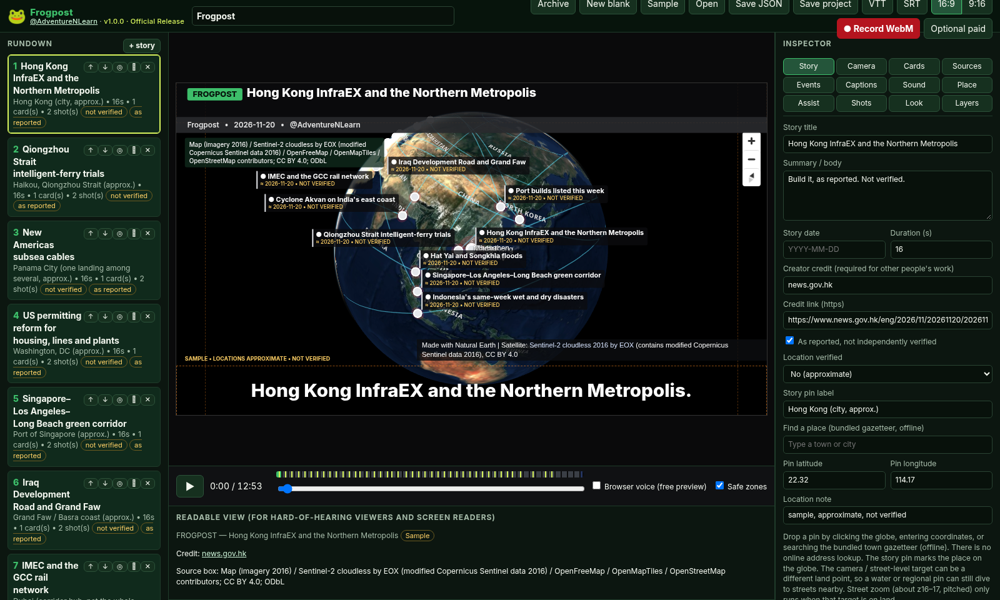
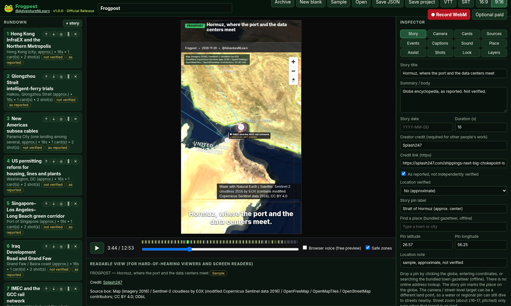

# GlobeDesk

**A free, local newsdesk and video studio on a talking globe.**

Pick your stories and the globe flies from orbit down to street level for each one. Cards pin to the place, every source carries a verified or unverified label, captions are always on, and you can record the result as a 16:9 or 9:16 video. It runs in your browser. You don't need an account, a server or an API key.

> **v1.0.0 · Official Release** · by [@AdventureNLearn](https://x.com/AdventureNLearn) · Live copy: [globedesk.grok.me](https://globedesk.grok.me)



## Contents

- [What you get](#what-you-get)
- [Quick start](#quick-start)
- [Make your own show (starter kit)](#make-your-own-show-starter-kit)
- [Frogpost, the showcase show](#frogpost-the-showcase-show)
- [Privacy and safety](#privacy-and-safety)
- [Documentation](#documentation)
- [Tests](#tests)
- [License and credits](#license-and-credits)

## What you get

- **Globe to street level.** You get one renderer (MapLibre GL JS, vendored) that goes from a 3D globe to pitched streets and buildings. If the network is down, it falls back to an offline globe.
- **A story editor.** Use it for stories, pins, cards, sources, captions (SRT/VTT), credits, and an "as reported, not verified" toggle.
- **Your own media.** Add video, images and audio. They are stored in your browser only, and you can place them as cards, pin popups, screen overlays, geo-anchored panels or allowlisted embeds.
- **Sound.** Add voiceover and sound overlays with volume, offset and loop. Both are mixed into playback and into the recording.
- **Event Layers.** Draw points, routes and areas, with GeoJSON, CSV and KML import and export.
- **Multi-card callouts.** Open several story cards on the globe at once (◎ in the rundown, or Shift-click a pin). Rings, cards and leader lines rescale and re-route as you zoom, never overlap, and nearby stories merge into one count badge until you zoom in.
- **Archive.** Every show and story you add keeps a card, and you can **bring it back** at any time.
- **Assist panel.** Copy a prompt into any assistant, paste back the JSON it returns, and GlobeDesk validates it before loading. GlobeDesk itself never calls a model.
- **Phone layout.** On a phone the globe comes first, the top-bar buttons move into a ☰ menu, and the panels fold.
- **Interactive mission demo.** A frog-guided tour lives under [`demo/`](demo/), and its guide pack can be swapped.

| Desk, 9:16 with header and citations | Phone layout |
|---|---|
|  |  |

## Quick start

**Windows (no install):** download and extract the release zip, then double-click `START-GLOBEDESK.bat`. See [WINDOWS-RUN.md](WINDOWS-RUN.md).

**Any OS:**

```bash
git clone https://github.com/AdventureNLearn/GlobeDesk.git
cd GlobeDesk
python3 tools/serve.py        # opens http://127.0.0.1:8080
```

Use a local server, not `file://`.

Useful URL options:

| Option | What it does |
|---|---|
| `?blank=1` | Start from a blank template |
| `?sample=1` | Load Frogpost |
| `?archive=<show id>` | Open an archived show |
| `?base=offline` | Use the bundled globe, with no network |
| `?aspect=9:16` | Use the vertical frame |
| `?t=25` | Seek to 25 seconds |
| `?import=/episodes/....json` | Import an episode (same-origin only) |

## Make your own show (starter kit)

The [`starter/`](starter/) folder is a clean baseline to take away. It also ships as **`globedesk-starter-v1.0.0.zip`** on the GitHub release.

| File | Use it for |
|---|---|
| `starter/MAKE-YOUR-OWN.md` | Step-by-step: story, pins, sources, layers, guide pack, export |
| `starter/episode-template.globedesk.json` | A blank, valid episode with placeholder fields |
| `starter/layer-template.geojson` | Point, route and area examples (placeholders, not real data) |
| `starter/guide-pack-template/` | A blank narrator pack for the mission demo |

Open the episode in GlobeDesk (**Open**), replace every `[UNKNOWN]`, and save. The data format is documented in [docs/STORY-FORMAT.md](docs/STORY-FORMAT.md).

## Frogpost, the showcase show

GlobeDesk opens on **Frogpost**, the show by [@AdventureNLearn](https://x.com/AdventureNLearn). It is a frog-narrated rundown of 48 things being built, flooded, filed or mapped, in five groups: Build it, Globe encyclopedia, Water and works, Receipts, and Frogpost.

- It is a **sample**. Locations are approximate, and claims are as reported, not verified.
- Every card links its source. The one exception is a single opinion card.
- The frog is the narrator, not the subject.
- You can remove it. Click **New blank** to start your own show.

An earlier geopolitics show by another creator is kept in the **Archive**, with its creator credit and links (see [CREDITS.md](CREDITS.md)).

## Privacy and safety

- **Nothing is uploaded.** Media lives in this browser's IndexedDB, and exports go to your Downloads folder.
- **No keys are needed.** Optional paid features (MapTiler, cloud voice, cloud AI) are off. Any key you paste stays in this browser's `localStorage`.
- **Strict inputs.** User text is sanitized, links must be https, embeds come from an allowlist and need a credit, imported JSON is schema-validated, and a Content-Security-Policy lists every allowed host.
- **The base map is never changed by content.** Your stories sit in a separate layer on top of the map. Loading or clearing a project leaves the map unchanged, and this is tested.
- **Third-party tiles have no uptime guarantee.** If they fail, the offline globe takes over.
- You are responsible for the rights to anything you upload, record or share. Credit other people's work.

Found a security issue? See [SECURITY.md](SECURITY.md).

## Documentation

| Doc | What's in it |
|---|---|
| [USER-GUIDE.md](USER-GUIDE.md) | A walkthrough of making a story, adding sound, placing media, assist, and saving |
| [docs/REFERENCE.md](docs/REFERENCE.md) | Every panel and tab, the Frogpost look, the episode model, Event Layers, map credits, the roadmap and known gaps |
| [docs/STORY-FORMAT.md](docs/STORY-FORMAT.md) | The `globedesk.episode/2` JSON format |
| [demo/README.md](demo/README.md) | The mission demo and guide packs |
| [GROK-ME-BUILD.md](GROK-ME-BUILD.md) | Rebuilding a hosted copy on Grok.me |
| [CHANGELOG.md](CHANGELOG.md) | Release notes |
| [CONTRIBUTING.md](CONTRIBUTING.md) | How to contribute |

## Tests

You need Node 20+, and Google Chrome for the smoke tests.

```bash
npm test                                     # unit suites (model, events, v0.4, Frogpost/archive, callouts)
node tests/smoke.mjs                         # headless Chrome load, fails on console errors, writes shots/
node tests/smoke-events.mjs                  # Event Layers in the browser
node tests/smoke-callouts.mjs                # several open cards at zoom 1.5/3/6/12, desktop and phone
python3 tools/make_grokme_manifest.py --check
python3 tools/scrub_scan.py                  # no private paths, emails or internal IDs in the tree
python3 tools/make_starter_zip.py            # builds the starter zip and scans it
```

## License and credits

- **Code:** MIT. See [LICENSE](LICENSE).
- **Content:** AdventureNLearn's content is [CC BY 4.0](LICENSE-CONTENT). That covers the episode text, the frog art, the voice-clip scripts, the British voice clips, the sound effects, screenshots and docs. Credit "AdventureNLearn".
- **Not covered by either:** third-party parts keep their own terms. This includes MapLibre (BSD-3), map data and tiles, fonts (OFL), and the creators and sources linked on cards.
- **US voice clips are non-commercial.** The demo's "US" voice (Piper `en_US-hfc_male-medium`) uses a CC BY-NC-SA 4.0 dataset (non-commercial, share-alike) and was fine-tuned from lessac (Blizzard 2013 license). Those clips are for non-commercial use only and are excluded from the CC BY 4.0 grant. The "British" voice (Piper `en_GB-vctk-medium`, CC BY 4.0 data) has no such limit. See [CREDITS.md](CREDITS.md).

Copyright (c) 2026 AdventureNLearn.
